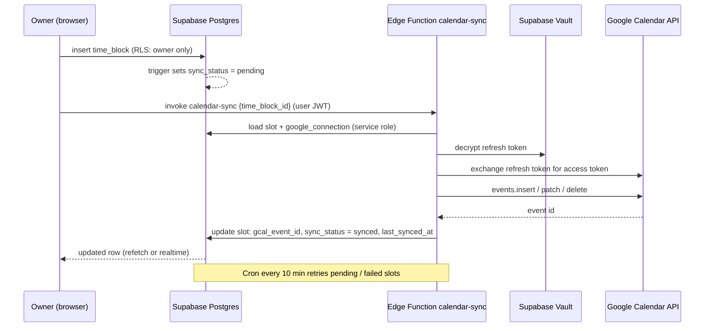
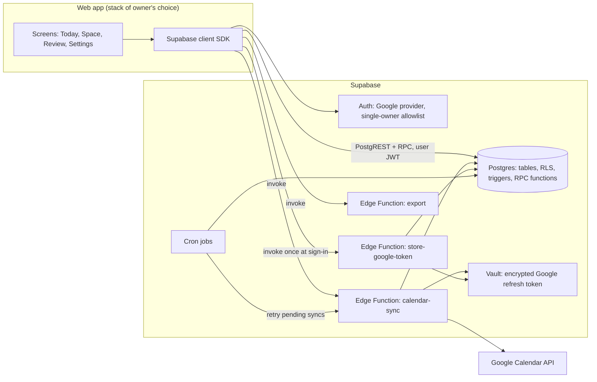
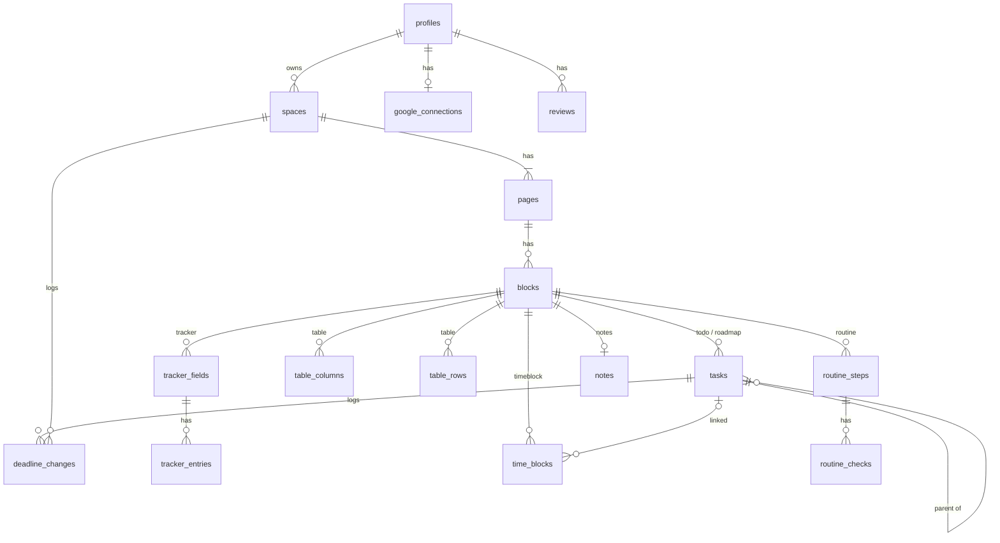

# Daybook — Product Requirements Document

| | |
|---|---|
| **Product** | Daybook (working name — replace everywhere once the final name is chosen) |
| **Type** | Private, single-user web app: a personal life operating system |
| **Owner / only user** | Kabid (kabid.snit@gmail.com) |
| **Version** | 1.0 (complete specification) |
| **Date** | 16 Oct 2026 |
| **Database & backend services** | Supabase (Postgres, Auth, Row Level Security, Edge Functions, Cron, Vault, Storage) |
| **Frontend stack** | Next.js + TypeScript on Vercel (decided 16 Oct 2026, see `docs/adr/0001-stack.md`). The rest of this document stays stack-agnostic. |
| **Design** | See `DESIGN.md` (separate file). This PRD never restates visual rules; it references DESIGN.md components by name. |
| **Builder** | Claude Code, phase by phase, using the requirement IDs and acceptance criteria in this file. |

---

## Table of contents

1. Summary
2. Goals, non-goals and principles
3. Glossary
4. The core model: Space → Page → Block
5. Website structure (sitemap and global UI)
6. Functional requirements (with acceptance criteria)
7. The deadline engine
8. Google Calendar integration
9. System design
10. Database design
11. Non-functional requirements
12. Seed content (the owner's starting setup)
13. Build phases and definition of done
14. How to build this with Claude Code
15. Open decisions
16. Appendices

---

## 1. Summary

Daybook is one person's life on one private website. It holds what the owner **plans** to do and records what he **actually did**, across everything: health, learning, his AI agency, finances, routines and personal life.

The site is organised the way the owner thinks:

- Each **goal** (Health, AI Engineering, AI Agency) has an **end goal and a strict deadline**, and is broken into smaller pieces, each with its own deadline, down to daily tasks.
- Each **life area** (Finance, Skincare, Personal) is ongoing and has no end date.
- Inside every goal or area, the owner creates **pages** (a tracker page, a roadmap page, a products page…) and fills them with **blocks** chosen from a fixed menu of seven: To-do list, Roadmap, Tracker, Table, Time block, Routine, Notes.
- A **Today** page gathers everything due today from every space, so opening the site always answers "what do I do now?".
- Scheduled time is pushed to the owner's **Google Calendar**.
- Deadlines are **strict**: the system refuses impossible deadlines, keeps late work visible until it is done, and makes every postponement deliberate and recorded.

The approved clickable demo (published earlier in this project) shows the intended behaviour. This PRD is the complete specification of it.

---

## 2. Goals, non-goals and principles

### 2.1 Goals
- **G1** One place for the owner's whole life: goals, routines, numbers, money, notes.
- **G2** Make deadlines impossible to ignore and hard to slide.
- **G3** Break big goals into small, dated, doable steps (goal → stage → step → daily task).
- **G4** Make daily tracking (weight, calories, study time, money) take seconds.
- **G5** Put scheduled time on Google Calendar automatically.
- **G6** Stay simple: one model (Space → Page → Block), seven block types, no special-case screens except Today and Review.

### 2.2 Non-goals (v1)
- Multiple users, teams, sharing or public pages.
- Native mobile apps (the site must still work on a phone browser).
- Two-way Google Calendar sync (Daybook writes to Calendar; it does not import events in v1).
- Bank or card imports for finance.
- Offline mode.
- A free-form canvas or nested pages-inside-pages like Notion. Pages are one level deep inside a space.

### 2.3 Product principles
1. **Deadlines are first-class data.** Every dated thing shows its deadline; late things are marked in words and in colour.
2. **Rules live in the database.** Deadline rules, ownership and integrity are enforced by Postgres constraints, triggers and RLS, so no client (including future AI tools) can break them.
3. **One model, many uses.** CRM, food log, finance ledger and product catalogue are all Table blocks with different columns, not separate features.
4. **Fast capture, calm review.** Logging takes one or two actions; analysis happens on the Space header, Today and the weekly Review.
5. **Nothing is silently lost.** Deletes are soft (Trash, 30 days); deadline changes are logged.

---

## 3. Glossary

| Term | Meaning |
|---|---|
| **Space** | A top-level container. Either a **Goal** or a **Life area**. |
| **Goal** | A space with an end goal, a start date and a deadline. It can be achieved, missed or archived. |
| **Life area** | A space with no end date (Finance, Skincare, Personal). |
| **End goal** | The one-sentence outcome of a goal ("Reach 72 kg and run a 5K without stopping"). |
| **Page** | A named document inside a space. A space has 1..n pages shown as tabs. |
| **Block** | A unit of content on a page, of one of seven **block types**. |
| **Task** | A checkable item with a deadline. Lives in a To-do block (flat) or a Roadmap block (as a step in a tree). |
| **Stage** | A top-level step in a Roadmap block. |
| **Step** | Any task inside a Roadmap; can be broken down into child steps. |
| **Deadline** | A date (and optional time) by which a task, stage or goal must be done. |
| **Overdue / late** | Not done and the deadline date is before today. |
| **Today** | The current date in the owner's timezone (default `Asia/Dhaka`). |
| **Milestone** | A task flagged to appear on the goal's Deadline Rail. Roadmap stages are milestones by default. |
| **Tracker field** | One number tracked over time (Weight, Calories, Study hours). |
| **Entry** | One value of a tracker field for one date. |
| **Time slot** | A booked period of time (date, start, end) in a Time block. Synced to Google Calendar. |
| **Routine** | A daily (or weekday-specific) checklist with a streak. |
| **Reschedule** | Changing a deadline after it was set. Requires a reason and is recorded. |
| **Deadline Rail** | The horizontal timeline at the top of every goal (see DESIGN.md). |
| **Index** | The sidebar listing Today, Goals, Life areas (see DESIGN.md). |

---

## 4. The core model: Space → Page → Block

```
Space   (Goal with deadline | Life area)
  └── Page   (any number, ordered, shown as tabs)
        └── Block   (any number, ordered; one of 7 types)
              └── Content   (tasks, steps, entries, rows, slots, routine steps, text)
```

### 4.1 The seven block types

| Type | What it is for | Content it holds | Dated? | Shows on Today? |
|---|---|---|---|---|
| **To-do list** | Tasks with strict deadlines | Flat list of tasks | Yes (required in goals) | Overdue, due today, next 7 days |
| **Roadmap** | Big steps broken into smaller ones | Tree of steps (max depth 4) | Yes (required) | Leaf steps: overdue, due today, next 7 days |
| **Tracker** | Numbers logged daily with a trend | Fields + one entry per field per day | Per entry date | "Log today" if not yet logged |
| **Table** | Records: products, clients, meals, money | Typed columns + rows | Optional date columns | No (v1) |
| **Time block** | Booking time, synced to Google Calendar | Time slots | Yes (date + times) | Day Timetable |
| **Routine** | Daily checklist with a streak | Steps + daily check marks | Per day | Routines section |
| **Notes** | Free writing | Rich text | No | No |

### 4.2 Why this shape
Every requirement the owner described maps onto these seven types:

| Owner's need | Built from |
|---|---|
| Calories, weight, what I ate today | Tracker (Weight, Calories) + Table ("What I ate", filtered to today) |
| AI course roadmap: Python → Databases → ML, broken into daily topics | Roadmap |
| Agency products, marketing, clients (CRM) | Table (Products), To-do + Notes + Time block (Marketing), Table with a Status column and board view (Clients) |
| Finance | Table with money and category columns, monthly summary |
| Skincare routine | Routine (Morning, Night) |
| Time blocking | Time block → Google Calendar |
| Notes, journal | Notes |

---

## 5. Website structure

### 5.1 Sitemap

| Route | Screen | Purpose |
|---|---|---|
| `/` | — | Redirects to `/today` when signed in, else `/login`. |
| `/login` | Sign in | Google sign-in. Only the owner's account is allowed. |
| `/today` | Today | Everything due today across all spaces; the home screen. |
| `/s/:spaceId` | Space | Redirects to the space's first page (or last opened page). |
| `/s/:spaceId/:pageId` | Space page | Space header + page tabs + the page's blocks. |
| `/s/:spaceId/settings` | Space settings | Name, mark colour, kind, end goal, dates, progress metric, status (achieve / miss / archive), delete. |
| `/new` | New space | Create a goal or life area (also available as an inline form in the Index). |
| `/review` | Weekly review | The current week's review. |
| `/review/:weekStart` | Past review | A saved weekly review. |
| `/history` | Deadline history | Every reschedule, with reasons (filterable by space). |
| `/settings` | Settings: Profile | Name, timezone, week start day, currency, theme. |
| `/settings/calendar` | Settings: Google Calendar | Connection status, connect / reconnect / disconnect, target calendar, "push deadlines" toggle, sync log. |
| `/settings/data` | Settings: Data | Export (JSON / CSV), Trash (restore / delete forever). |
| `/*` | Not found | Plain message and a link to Today. |

Deep links: page and block anchors are supported (`/s/:spaceId/:pageId#block-:blockId`) so Today rows can jump straight to the source block.

### 5.2 Global UI (present on every signed-in screen)

| Element | Description |
|---|---|
| **Index (sidebar)** | Wordmark; **Today** with a red late-count when anything is overdue; **Goals** list (each with days left); **Life areas** list; **+ New space**; link to **Review**; link to **Settings** at the bottom. Spaces can be reordered by drag. Archived spaces are hidden behind "Archived (n)". |
| **Command palette** | `Ctrl/Cmd + K`. Jump to any space or page; search tasks, notes, table rows; run actions ("New task", "Log weight", "New space"). |
| **Quick capture** | Press `N` anywhere (or the "+ Task" button in the Index) to add a task: title, space, target block (defaults to the space's first To-do block), deadline. |
| **Toast** | Confirms actions and shows errors (see DESIGN.md). Destructive actions offer **Undo** for 6 seconds. |
| **Theme** | System / light / dark (DESIGN.md defines both themes). |

### 5.3 Screen: Today (`/today`)

Purpose: answer "what must I do today, and what did I miss?" in one look.

Layout (two columns on desktop, stacked on narrow screens):

**Header**
- Two-tone headline: date in full ("Friday, 16 October") + a plain statement ("3 things due today.").
- KPI row: Late, Due today, Time blocks, Routine steps (e.g. `2 · 3 · 3 · 2/7`).
- **Goals strip**: one aura card per active goal (max 3 visible, scroll for more) showing the goal's progress %, days left and its next milestone; clicking opens the space.

**Left column: Agenda**
1. **Overdue**: every unfinished task (To-do items and Roadmap leaf steps) whose deadline is before today, oldest first. Shown on a signal-wash band. Each row: checkbox, title, source ("Health · Workouts" or "AI Engineering · Roadmap · Learn Python"), deadline tag ("2d late"), and actions **Done** and **Reschedule** (opens the reschedule dialog, §7.4). Hidden entirely when empty.
2. **Due today**: tasks due today; unfinished first, finished struck through at the bottom.
3. **Next 7 days**: unfinished tasks due tomorrow through today+7, grouped by date.

**Right column**
4. **Day Timetable**: hour ruler 06:00–24:00 with today's time slots at their real times and a NOW line; below it a list of today's slots with their Google Calendar status and an "Add to Google Calendar" button for unsynced ones.
5. **Routines**: every Routine block scheduled for today, with its steps as checkboxes and the current streak.
6. **Trackers**: every Tracker block with a compact "log today" form (one input per field, pre-filled if already logged). Shows "Logged" once today's values exist.
7. **Quick capture** input at the bottom of the agenda: "Add a task for today…" (space picker, defaults deadline to today).

Every row links to its source block (§5.1 deep link).

### 5.4 Screen: Space page (`/s/:spaceId/:pageId`)

**Space header** (DESIGN.md: "Space view anatomy")
- Breadcrumb: mark + "Goal" or "Life area".
- Space name; **Countdown** (days left) on the right for goals.
- End goal sentence (goals only).
- **Deadline Rail** (goals only): start date → deadline, month ticks, milestone ticks (done / upcoming / late), elapsed segment, NOW line. Below it, a one-line list of upcoming milestones with dates.
- **Progress line** (goals only): percentage + plain-language label, computed by the goal's metric (§6.2, SPC-7).
- For life areas, the header shows only breadcrumb, name and an optional one-line description.

**Page tabs**: one tab per page; "+ Page"; drag to reorder; right-click/overflow menu: rename, duplicate, move to another space, delete.

**Page body**: editable page title, then the blocks in order, then "+ Add a block" which opens the block menu (seven types with one-line descriptions). Typing `/` on an empty page also opens it.

**Block chrome** (every block): type tag, editable title, overflow menu (rename, duplicate, move to another page, collapse, delete), drag handle for reordering.

### 5.5 Screen: Space settings (`/s/:spaceId/settings`)
Fields: name; mark colour (6 aura palettes from DESIGN.md); optional cover photo (upload, crop, remove; stored in Supabase Storage); kind (goal / life area; changing goal → area removes deadline rules after confirmation); end goal; start date; deadline (changing it later goes through the reschedule dialog); progress metric and its configuration; description (areas). Status actions: **Mark achieved**, **Close as missed**, **Archive**, **Delete** (to Trash).

### 5.6 Screen: Weekly review (`/review`)
Generated for the owner's week (week start configurable). Sections:
1. **Deadlines**: tasks due this week: done on time, done late, still open, rescheduled (with reasons). On-time rate = done on time ÷ (done + still open past deadline).
2. **Goals**: each goal's progress at the start and end of the week, days left, milestones hit or missed.
3. **Trackers**: each tracker field's weekly average, change versus previous week, days logged out of 7.
4. **Routines**: completion rate per routine, current streaks.
5. **Money**: income, expenses and net for the week from Table blocks with money columns.
6. **Reflection**: three free-text prompts saved with the review: "What went well?", "What slipped and why?", "What is the one priority next week?".
7. **Save review** stores a snapshot (stats + reflection) so past reviews never change.

### 5.7 Screen: Deadline history (`/history`)
A table of every reschedule: date changed, item, space, old deadline → new deadline, days moved, reason, whether it was overdue at the time. Filters: space, date range. Shows per-space totals ("AI Engineering: 4 reschedules, 11 days moved this month").

### 5.8 Screens: Settings
- **Profile**: display name, timezone (default `Asia/Dhaka`), week starts on (default Saturday; options Sat / Sun / Mon), currency (default BDT, symbol ৳), theme.
- **Google Calendar**: see §8.
- **Data**: export everything (JSON), export a single Table or Tracker (CSV); Trash with restore and delete-forever; items in Trash are purged after 30 days.

---

## 6. Functional requirements

Each requirement has an ID. Acceptance criteria (AC) are written so they can be turned directly into tests. "Owner" = the signed-in user.

### 6.1 Authentication and access (AUTH)

**AUTH-1 Sign in with Google.** The only sign-in method is Google OAuth via Supabase Auth.
- AC1: Given the owner on `/login`, when he chooses "Continue with Google" and approves, then he lands on `/today` signed in.
- AC2: The sign-in request asks for the Google Calendar events scope and offline access (see §8) so Calendar sync works without a second consent screen.

**AUTH-2 Single owner only.**
- AC1: Given any Google account other than the owner's allowed email, when it attempts to sign in, then no user record is created and `/login` shows "This Daybook is private."
- AC2: New sign-ups are disabled in Supabase after the owner's account exists, and the allowlist is also enforced server-side (Auth hook or allowlist check), not only in the UI.

**AUTH-3 Session.**
- AC1: Sessions persist across browser restarts until the owner signs out.
- AC2: Every route except `/login` redirects to `/login` when there is no session.
- AC3: "Sign out" is available in Settings and ends the session on the device.

### 6.2 Spaces (SPC)

**SPC-1 Create a space.** Fields: name (required, 1–60 chars), kind (goal | area), mark colour, and for goals: end goal (required, 1–200 chars), start date (default today), deadline (required, ≥ start date).
- AC1: Creating a goal without a deadline is rejected with "A goal needs a deadline."
- AC2: A new space is created with one page named "Overview" and opens on that page with the block menu open.
- AC3: The new space appears in the Index under Goals or Life areas at the bottom of its group.

**SPC-2 Edit a space.** Name, mark colour, end goal and description can be edited inline or in settings. Changing the **deadline** of a goal goes through the reschedule flow (§7.4).
- AC1: Editing the deadline directly (without a reason) is not possible from any screen.

**SPC-3 Order spaces.** Drag to reorder within each Index group; order persists.

**SPC-4 Goal statuses.** `active` → `achieved` | `missed` | `archived`; areas: `active` | `archived`.
- AC1: Marking a goal achieved records the date and moves it to "Achieved" under the Goals list (collapsed).
- AC2: When a goal's deadline passes and it is still `active`, the Countdown reads "N days past deadline" in signal colour, and the space header shows a banner: "This goal's deadline has passed. Mark achieved, close as missed, or extend (with a reason)."
- AC3: Archived spaces and their tasks disappear from Today and the Index (except "Archived (n)").

**SPC-5 Delete a space.** Moves the space, its pages, blocks and contents to Trash (soft delete).
- AC1: Undo is offered for 6 seconds; restore is possible from Trash for 30 days.

**SPC-6 Countdown.** For goals: days from today to deadline (deadline day counts as 0 = "due today").
- AC1: With today = 16 Oct 2026 and deadline = 31 Jan 2027, the Countdown shows 107.

**SPC-7 Progress metric.** Each goal has exactly one metric type:

| Metric | Configuration | Progress % | Label example |
|---|---|---|---|
| `tasks` (default) | — | done tasks ÷ all tasks in the space (To-do items + Roadmap leaf steps; deleted excluded) | "14 of 52 steps done" |
| `tracker` | tracker field, start value, target value | (start − latest) ÷ (start − target), clamped 0–100; works for decreasing and increasing targets | "77.2 kg now · started 78.4 · target 72" |
| `table_count` | table column (select), option value, target count | rows with that option ÷ target, clamped | "2 of 5 retainer clients" |
| `manual` | owner enters % | as entered | "Set manually: 40%" |

- AC1: Changing the metric recalculates the Progress line immediately.
- AC2: If the configured tracker field or table column is deleted, the metric falls back to `tasks` and the space settings show a notice.

**SPC-8 Deadline Rail.** Rendered for goals per DESIGN.md.
- AC1: Milestones = Roadmap stages in this space + any task with `is_milestone = true`.
- AC2: Milestone marker state: done → filled; not done and deadline < today → late (signal); otherwise hollow.
- AC3: The NOW line sits at today's position; the elapsed segment spans start date → today.
- AC4: Hovering a milestone shows its title and deadline.

**SPC-9 Area → goal conversion** (added 16 Oct 2026). Changing a life area into a goal is blocked while any of its live tasks has no due date or is due after the new deadline. Enforced in the database.
- AC1: The rejection lists every blocking task (title and current due date, or "no deadline") so the owner can fix them first.

### 6.3 Pages (PG)

**PG-1 Create a page.** "+ Page" creates "Untitled page", selects it and focuses its title for renaming.
**PG-2 Rename** inline (Enter or blur saves; empty name reverts to "Untitled page").
**PG-3 Reorder** tabs by drag; order persists.
**PG-4 Duplicate** a page with all blocks and structure. Tasks are copied as not done; tracker entries, table rows, routine checks and time slots are **not** copied (structure only), with a toggle "Include content".
**PG-5 Move** a page to another space. Deadline rules are re-checked against the destination: if any task would violate them (§7.2), the move is blocked and the conflicting tasks are listed.
**PG-6 Delete** to Trash with Undo.
- AC (all): A space always has at least one page; deleting the last page is blocked with "A space needs at least one page."
- AC: Opening a space returns to the page last opened in that space.

### 6.4 Blocks: common behaviour (BLK)

**BLK-1 Add a block** from the block menu (seven types). New blocks get the type's name as title and a sensible empty state (see each type).
**BLK-2 Rename** the block title inline.
**BLK-3 Reorder** blocks within a page by drag handle or keyboard (`Alt+↑/↓`).
**BLK-4 Move** a block to another page (any space). Same deadline re-check as PG-5.
**BLK-5 Duplicate** a block (structure; content toggle like PG-4).
**BLK-6 Collapse** a block to its header; state persists per block.
**BLK-7 Delete** to Trash with Undo; all child content goes with it.
**BLK-8 Resize**: each block has a width on a 12-column grid (S = 4, M = 6, L = 8, Full = 12; defaults per type in DESIGN.md). Blocks flow left to right and wrap; on narrow screens every block is full width.
- AC1: Every block can be reached by URL anchor `#block-:id`.
- AC2: Block order and collapsed state persist across reloads and devices.

### 6.5 To-do list block (TODO)

**TODO-1 Add task**: title (required, 1–200 chars), deadline date (required in goal spaces, optional in life areas), optional deadline time, optional note.
- AC1: In a goal space, a deadline after the goal's deadline is rejected: "That deadline is after the goal ends (31 Jan 2027). Pick an earlier date." The date picker's maximum is set to the goal's deadline.
- AC2: A task without a deadline in a goal space cannot be saved.

**TODO-2 Complete / un-complete** with the checkbox. Records `completed_at`. If completed after its deadline date, it is marked "done late" (shown in Review and on hover).
**TODO-3 Order**: default sort is unfinished by deadline (then time, then manual position), finished at the bottom. Toggle "Hide done" per block. Manual order available as an alternative sort.
**TODO-4 Edit** title and note inline. Changing the deadline uses the reschedule flow (§7.4) once the task exists.
**TODO-5 Milestone flag**: a task can be marked "Show on Deadline Rail".
**TODO-6 Schedule it**: "Book time" on a task creates a time slot (§6.9) linked to the task, in the first Time block on the same page (or creates one).
**TODO-7 Repeat** (phase 4): a task can repeat (daily, weekdays, weekly on chosen days, monthly on a date). Completing a repeating task creates the next occurrence with the next deadline.
- AC: Deadline tags follow §7.5 exactly.

### 6.6 Roadmap block (RM)

**RM-1 Stages**: add a stage with title and deadline (required; ≤ goal deadline in goal spaces).
**RM-2 Break down**: any step can be broken into child steps (title + deadline). Maximum depth 4 (stage → step → step → step).
- AC1: A child's deadline must be ≤ its parent's deadline. The date picker's max is the parent's deadline and the form says "Must be due by 15 Nov, the deadline of 'Learn Python'." Violations are rejected by the database too.
- AC2: Breaking down a step that was already done un-completes it (it now depends on its children).
**RM-3 Completion**: only leaf steps have checkboxes. A parent is done when all its children are done; un-checking a child un-completes the parent chain.
**RM-4 Progress**: each parent shows a mini progress bar and "done/total" of its leaf steps; the block shows overall leaf progress.
**RM-5 Expand / collapse** parents; state persists.
**RM-6 Reorder** siblings by drag; moving a step to another parent re-checks the deadline rule.
**RM-7 Parent deadline changes**: moving a parent's deadline earlier than any child's deadline is blocked and lists the children that must move first (or offers "Move these children to the new date" which reschedules them with the same reason in one action).
**RM-8 Today integration**: leaf steps appear on Today exactly like To-do tasks, with source "Space · Page · Stage".
- AC: With today = 16 Oct, a leaf "Loops: for and while" due 16 Oct appears in Today → Due today with source "AI Engineering · Roadmap · Learn Python".

### 6.7 Tracker block (TRK)

**TRK-1 Fields**: a tracker has 1–8 fields. Each field: label (required), unit (optional), decimals (0–3, default 1), optional daily target with a target kind: `at_most` (e.g. calories ≤ 2000), `at_least` (e.g. study ≥ 2 h), `reach` (a goal value, e.g. weight 72).
- AC1: A new tracker opens in setup mode: "What do you want to track?" (label, unit, target). It switches to logging mode once one field exists.
**TRK-2 Log**: one entry per field per date. "Log today" form shows one input per field, pre-filled with today's values if present; submitting updates them. Past dates can be logged or edited via a date picker on the form.
- AC1: Logging the same field twice on one date updates the existing entry (never two entries).
- AC2: Leaving a field empty does not create or clear that field's entry.
**TRK-3 Display per field**: current (latest) value with unit; meta line: for targeted fields "7-day average X · target Y" (with "on target" / "over" / "under" in words), otherwise "change over the last 14 entries"; a line chart with range toggle 14 / 30 / 90 days, target line when a target exists (chart spec in DESIGN.md).
**TRK-4 History**: "View all entries" opens a table of entries by date with edit and delete.
**TRK-5 Streak of logging**: "Logged N days in a row" for the tracker (any field logged counts).
**TRK-6 Edit / reorder / archive fields**: archiving hides a field but keeps its entries.
- AC (Today): Trackers without an entry for today show the log form; those with one show "Logged" and the values.

### 6.8 Table block (TBL)

**TBL-1 Columns**: 1–20 columns. Kinds: `text`, `number`, `money`, `date`, `select`, `checkbox`, `url`. Each column has a name and, for `select`, an ordered list of options; each option has a label and a tone (`active`, `neutral`, `early`, `closed`) used for display per DESIGN.md.
- AC1: A new table opens in setup mode: "Name the columns, separated by commas", creating `text` columns that can then be retyped.
**TBL-2 Rows**: add (inline form at the bottom), edit cells inline, delete (Trash), reorder by drag.
- AC1: Cell values are validated by column kind (number, money and date reject invalid input with a message).
**TBL-3 Money**: amounts in the profile currency (default BDT, shown as ৳ with thousands separators). A money column can be marked **signed** (income positive, expense negative). Signed money columns show a summary strip: Income, Expenses, Net for the rows currently visible.
**TBL-4 Summary row**: per numeric/money column choose none / sum / average / count; shown in a footer.
**TBL-5 Sort and filter**: sort by any column; filter by select option, checkbox, text contains, and date presets (today, this week, this month, custom range). Filters and sort are saved per block.
- AC: The "What I ate" table filtered to "Date = today" shows only today's meals and its Calories sum.
**TBL-6 Board view** (phase 4): a table with a select column can switch to a board: one column per option, rows as cards; dragging a card changes the select value. This is the agency CRM pipeline.
**TBL-7 Group by month** for tables with a date column (finance ledger): collapsible month groups, each with its own summary.
**TBL-8 CSV export / import** of a single table (import maps CSV headers to columns; phase 4).

### 6.9 Time block (TB)

**TB-1 Slots**: title (required), date, start time, end time, optional linked task.
- AC1: End must be after start: "The end time needs to be after the start time."
- AC2: Slots may not cross midnight in v1.
**TB-2 List**: slots sorted by date and start; past slots dimmed; "Show past" toggle.
**TB-3 Google Calendar**: each slot shows its sync status: *Not on calendar* (button "Add to Google Calendar"), *Syncing*, *On Google Calendar* (with link to the event), *Sync failed* (with "Retry" and the reason).
**TB-4 Auto-sync setting**: per Time block, "Add new slots to Google Calendar automatically" (default on once Calendar is connected).
**TB-5 Edits propagate**: editing a synced slot's title, date or times updates the Calendar event; deleting the slot deletes the event.
**TB-6 Linked task**: a slot linked to a task shows the task's title and deadline; completing the task does not delete the slot.
- AC: Overlapping slots are allowed but Today's timetable shows them side by side with an "Overlaps" note.

### 6.10 Routine block (RT)

**RT-1 Steps**: ordered list of steps (label required); add, rename, reorder, archive.
**RT-2 Schedule**: every day (default) or chosen weekdays (e.g. retinol routine Mon/Wed/Fri).
**RT-3 Daily checks**: checking a step records it for **today** (owner's timezone). The checklist resets at local midnight because checks are stored per date; nothing needs to be cleared.
**RT-4 Streak**: the number of consecutive **scheduled** days on which all active steps were checked, counting back from yesterday, plus today if today is already complete. Unscheduled days are skipped (they neither break nor extend the streak). Today being incomplete does not break the streak until the day ends.
- AC1: Morning routine complete on each of the last 12 scheduled days, today 2 of 4 steps done → "Streak 12 days". After checking the remaining 2 → "Streak 13 days" and a toast.
**RT-5 History**: a 12-week calendar strip per routine (day squares: complete / partial / missed / not scheduled).

### 6.11 Notes block (NOTE)

**NOTE-1 Rich text**: paragraphs, headings (2 levels), bulleted and numbered lists, checkboxes (non-deadline), bold, italic, inline code, code block, links, quote, divider. Markdown shortcuts (`# `, `- `, `1. `, `[] `, ``` ``` ```).
**NOTE-2 Autosave** while typing (debounced ~1 s) with a quiet "Saved" indicator; no save button.
**NOTE-3 Search**: note text is included in the command palette search.
**NOTE-4 Convert to task**: selecting a line → "Make task" creates a task in the space's first To-do block (deadline required in goals).

### 6.12 Today (TODAY)
Specified in §5.3. Additional rules:
- **TODAY-1** "Today" is computed in the profile timezone; the page updates its date at local midnight if left open.
- **TODAY-2** Only `active` spaces contribute; archived, achieved and missed spaces do not.
- **TODAY-3** Completing, rescheduling, logging and checking from Today update the source block immediately (and vice versa).
- **TODAY-4** The late-count in the Index equals the number of rows in Overdue.
- AC (with the seed data and today = 16 Oct 2026): Overdue shows "Buy running shoes" (2d late, Health · Workouts) and "Send proposal follow-up to Bayside Café" (1d late, AI Agency · Marketing); the Index shows a late-count of 2.

### 6.13 Search and command palette (SRCH)
- **SRCH-1** `Ctrl/Cmd+K` opens the palette from anywhere.
- **SRCH-2** Results grouped: Spaces, Pages, Tasks, Notes, Table rows; keyboard navigable; Enter opens the source (with the block anchor).
- **SRCH-3** Actions: New task, New space, New page here, Log tracker…, Go to Today, Open Review.
- AC: Results return in under 300 ms for a dataset of 10,000 tasks/rows.

### 6.14 Quick capture (CAP)
- **CAP-1** `N` (when not typing in a field) opens a small dialog: title, space (default: last used), block (default: first To-do block in that space), deadline (default: today).
- **CAP-2** The same deadline rules apply (§7.2).

### 6.15 Weekly review (REV)
Specified in §5.6.
- **REV-1** The review is computable at any time for the current week; saving stores a snapshot.
- **REV-2** On the first day of a new week, Today shows a one-line prompt "Review last week" until the review is saved or dismissed.

### 6.16 Settings and data (SET)
- **SET-1** Profile fields (§5.8) persist and take effect immediately (changing timezone re-computes Today).
- **SET-2** Export all data as one JSON file containing every table in §10 for the owner (excluding Google tokens).
- **SET-3** Trash lists deleted spaces, pages, blocks, tasks and rows with deletion date; restore puts the item back in its original place (or the space's first page if the original page is gone); "Delete forever" removes it; a daily job purges items older than 30 days.

---

## 7. The deadline engine

The owner said strict deadlines are what make him finish things. These rules are the heart of the product and are enforced in the database (§10.6) as well as the UI.

### 7.1 What has a deadline
- Goal spaces: `deadline` (date), required.
- Tasks in goal spaces (To-do items and Roadmap steps): `due_date` required, `due_time` optional.
- Tasks in life areas: `due_date` optional.
- Time slots: date + start/end (they are appointments, not deadlines).

### 7.2 Containment rules
- **DL-1** Task `due_date` ≤ its space's deadline (goal spaces).
- **DL-2** Roadmap child `due_date` ≤ parent `due_date`.
- **DL-3** A parent's deadline cannot be moved earlier than any child's deadline (RM-7).
- **DL-4** A goal's deadline cannot be moved earlier than any of its tasks' deadlines (the reschedule dialog lists them and offers to move them together).
- **DL-5** Goal `start_date` ≤ `deadline`.

### 7.3 Status of a dated task (computed, never stored)

| Status | Condition |
|---|---|
| `done_on_time` | done, and completed date (owner timezone) ≤ due_date |
| `done_late` | done, and completed date > due_date |
| `late` | not done, due_date < today |
| `due_today` | not done, due_date = today |
| `upcoming` | not done, due_date > today |
| `undated` | no due_date (life areas only) |

### 7.4 Rescheduling (moving a deadline)
- **DL-6** Once a task or goal has a deadline, changing it is a **reschedule**: the owner must enter a reason (min 3 characters). Quick picks are offered (Tomorrow, +3 days, Next week, Pick a date), but the reason is always required.
- **DL-7** Every reschedule is written to `deadline_changes` (old date, new date, reason, whether it was late at the time, timestamp).
- **DL-8** A task shows "moved N×" next to its deadline tag after its first reschedule.
- **DL-9** Rescheduling must satisfy the containment rules; the dialog explains any conflict.
- **DL-10** Late tasks stay in Today → Overdue until they are completed or rescheduled. There is no "dismiss".
- **DL-11** Deleting a late task requires confirmation and is recorded in `deadline_changes` with kind `deleted_while_late`.
- **DL-12** (added 16 Oct 2026) A late task cannot be soft-deleted by setting `deleted_at` directly; it must go through `delete_task`, so DL-11 cannot be bypassed. Enforced in the database.
- **DL-13** (added 16 Oct 2026) Soft-deleted tasks are ignored by the containment rules DL-1 to DL-4. Restoring a task from Trash re-checks those rules; if the restored task would break one, the restore is refused, the message names the rule, and the owner is asked to reschedule first.
- AC1: Given task "Buy running shoes" due 14 Oct, today 16 Oct, when the owner reschedules it to 18 Oct with reason "Shop closed", then the task leaves Overdue, shows "in 2d · moved 1×", and `/history` lists the change with "was late: yes".
- AC2: Attempting to update `due_date` directly through the database API (not via the reschedule function) on an existing goal task is rejected.

### 7.5 Deadline tag text (UI contract)
| Case | Text |
|---|---|
| Done | original date, struck through (e.g. "14 Oct") |
| Late | "Nd late" (e.g. "2d late") |
| Today | "today" (plus time if set: "today 18:00") |
| Tomorrow | "tomorrow" |
| 2–6 days | "in Nd" |
| Otherwise | "25 Oct"; with year if not the current year ("31 Jan 2027") |
Full date ("Wed 14 Oct 2026") is always available on hover. Styles per DESIGN.md "Deadline tag".

### 7.6 Notifications (v1 scope)
- In-app: late-count on Today in the Index; Overdue section; space banner for passed goal deadlines.
- Google Calendar: time slots always (when connected); optionally **deadlines as all-day events** ("Due: Loops: for and while") with a reminder at 09:00 local (setting `push_deadlines`, default off).
- Email/push notifications are out of scope for v1 (§15).

---

## 8. Google Calendar integration (GC)

### 8.1 Scope of v1
One-way: Daybook → Google Calendar. Daybook creates, updates and deletes events it owns. It never reads or changes other events.

### 8.2 Connection
- **GC-1** Google sign-in (AUTH-1) requests the scope `https://www.googleapis.com/auth/calendar.events` with `access_type=offline` and `prompt=consent`, so Google returns a refresh token.
- **GC-2** Supabase Auth does **not** store Google's tokens. At the sign-in callback, the app captures the session's `provider_refresh_token` (and `provider_token`) once and sends them to a server-side function that stores the refresh token **encrypted** (Supabase Vault) in `google_connections`. The browser never stores or reads it afterwards.
- **GC-3** Target calendar: the owner's primary calendar by default. Optional: a dedicated "Daybook" calendar (creating a secondary calendar needs a broader scope; verify the minimal scope at build time and ask for it only if this option is enabled).
- **GC-4** `/settings/calendar` shows: connected Google account, target calendar, last successful sync, number of failed syncs, toggles (`push_deadlines`, default auto-sync for new Time blocks), buttons **Reconnect** and **Disconnect**.
- **GC-5** Disconnect revokes the token at Google, deletes the stored token, and marks all slots *Not on calendar* (events already on Google stay unless the owner ticks "Also remove Daybook events from my calendar").

### 8.3 Sync behaviour
- **GC-6** Creating, editing or deleting a time slot sets its `sync_status` to `pending` (database trigger). The client immediately invokes the `calendar-sync` Edge Function for that slot; a scheduled job also retries pending and failed slots every 10 minutes.
- **GC-7** Event mapping: summary = slot title; description = "From Daybook · {Space} · {Page}" + a link back to the block; start/end = slot date + times in the profile timezone; `extendedProperties.private.daybookId` = slot id (used to find and de-duplicate events).
- **GC-8** Idempotency: if a slot already has `gcal_event_id`, the function patches that event; if Google returns 404/410, it recreates the event and stores the new id.
- **GC-9** Failures: on error, `sync_status = failed`, `sync_error` stores a short reason, retries use backoff (10 min, 30 min, 2 h, then daily); after 5 failures the slot stops retrying until the owner presses Retry.
- **GC-10** Token problems (revoked/expired refresh token) set `google_connections.status = needs_reconnect`; Today and Settings show "Reconnect Google Calendar" and no sync is attempted until reconnected.
- **GC-11** Deadlines as events (when `push_deadlines` is on): one all-day event per dated, unfinished task in active spaces; completing or deleting the task removes the event; rescheduling moves it.
- AC1: Given Calendar connected, when the owner adds slot "Python: loops", today 20:00–21:30, then within 10 s the slot shows "On Google Calendar" and the event exists in Google Calendar at 20:00–21:30 Asia/Dhaka.
- AC2: When the slot's end is changed to 22:00, the same Google event (same id) now ends at 22:00.
- AC3: When the slot is deleted, the Google event is deleted.

### 8.4 Sync sequence



---

## 9. System design

### 9.1 Architecture



### 9.2 Responsibilities

| Component | Responsibility |
|---|---|
| **Web app** | All screens in §5; optimistic UI updates; client-side validation mirroring DB rules (for messages); date maths in the profile timezone. Talks to Supabase only through the official client with the owner's JWT. |
| **Supabase Auth** | Google OAuth; session management; single-owner enforcement. |
| **Postgres** | Source of truth. Every table has RLS. Business rules (deadline engine, ownership, integrity) as constraints, triggers and RPC functions (§10.6–10.8). |
| **RPC functions** | Multi-row or rule-heavy operations that must be atomic: reschedule, reorder, move page/block, get Today, space progress, streaks, weekly review stats, restore from trash. |
| **Edge Function `store-google-token`** | Receives provider tokens right after sign-in, stores the refresh token in Vault, upserts `google_connections`. |
| **Edge Function `calendar-sync`** | Pushes one or many pending items (slots, deadline events) to Google Calendar (§8.3). |
| **Edge Function `export`** | Builds the JSON export (or CSV for one block) and returns it as a download. |
| **Cron** | Every 10 min: retry calendar syncs. Daily 03:00 local: purge Trash older than 30 days; recompute nothing else (all stats are computed on read). |
| **Vault** | Encrypted storage of the Google refresh token. Readable only by service-role code. |

### 9.3 Data flow principles
- **Reads**: the app reads tables directly through RLS-protected queries, plus RPCs for computed views (Today, progress, streaks, review).
- **Writes**: simple edits (rename, check a box, add a row) are direct table writes. Rule-heavy changes (reschedule, move, reorder, restore) go through RPCs.
- **Computed, not stored**: task status, progress %, streaks, averages, summaries. Only snapshots (saved weekly reviews) store computed numbers.
- **Time**: the database stores dates as `date` (local calendar dates) and instants as `timestamptz`. "Today" is passed from the client as the owner's local date **or** computed in SQL as `(now() at time zone profile.timezone)::date`; RPCs accept an optional `p_today` for testability.
- **Ordering**: `position` is a `numeric` fractional index (insert between neighbours without renumbering).
- **Realtime**: not required in v1 (single user). Optional later for multi-tab freshness.

### 9.4 Security model
- Row Level Security on every table: `owner_id = auth.uid()` for select/insert/update/delete. `owner_id` defaults to `auth.uid()`.
- `google_connections` has **no** client-facing select policy; the app reads safe fields through RPC `get_calendar_status()`.
- Single-owner enforcement in two layers: sign-ups disabled after the owner exists, plus a server-side allowlist check (Auth hook or trigger on `auth.users`).
- Secrets (Google client secret, service role key) live only in Supabase/Edge Function environment variables, never in the client.
- Financial and health data never leave Supabase except in the owner's own exports.

### 9.5 Environments
- **Local / dev**: Supabase local stack or a dev project, seeded with §12 data.
- **Production**: one Supabase project. Database changes only through versioned migrations.

---

## 10. Database design

All tables live in the `public` schema unless noted. Every table has `owner_id uuid not null default auth.uid() references auth.users(id) on delete cascade`, `created_at timestamptz not null default now()`, and (where content is editable) `updated_at timestamptz not null default now()` maintained by a trigger. Soft-deletable tables have `deleted_at timestamptz null`. These common columns are omitted from the tables below unless relevant.

### 10.1 Enums

| Enum | Values |
|---|---|
| `space_kind` | `goal`, `area` |
| `space_status` | `active`, `achieved`, `missed`, `archived` |
| `mark_color` | `moss`, `slate`, `ochre`, `teal`, `clay`, `graphite` |
| `goal_metric` | `tasks`, `tracker`, `table_count`, `manual` |
| `block_type` | `todo`, `roadmap`, `tracker`, `table`, `timeblock`, `routine`, `notes` |
| `target_kind` | `at_most`, `at_least`, `reach` |
| `column_kind` | `text`, `number`, `money`, `date`, `select`, `checkbox`, `url` |
| `summary_kind` | `none`, `sum`, `avg`, `count` |
| `sync_status` | `not_synced`, `pending`, `synced`, `failed`, `delete_pending` |
| `connection_status` | `connected`, `needs_reconnect`, `disconnected` |
| `deadline_change_kind` | `reschedule`, `deleted_while_late` |
| `theme_pref` | `system`, `light`, `dark` |

### 10.2 Entity relationship diagram



### 10.3 Tables

#### `profiles`
| Column | Type | Null | Default | Notes |
|---|---|---|---|---|
| id | uuid | no | — | PK, = `auth.users.id` |
| display_name | text | yes | | |
| timezone | text | no | `'Asia/Dhaka'` | IANA name; validated |
| week_starts_on | smallint | no | `6` | 0=Sun … 6=Sat |
| currency | text | no | `'BDT'` | ISO 4217 |
| theme | theme_pref | no | `'system'` | |
| last_page_by_space | jsonb | no | `'{}'` | `{spaceId: pageId}` |

#### `spaces`
| Column | Type | Null | Default | Notes |
|---|---|---|---|---|
| id | uuid | no | `gen_random_uuid()` | PK |
| kind | space_kind | no | | |
| name | text | no | | 1–60 chars |
| mark | mark_color | no | `'graphite'` | selects the space's aura palette (DESIGN.md) |
| cover_path | text | yes | | optional cover photo in the private Storage bucket `covers` (shown blurred behind the space hero) |
| description | text | yes | | areas |
| end_goal | text | yes | | required when `kind='goal'` |
| start_date | date | yes | | required when goal |
| deadline | date | yes | | required when goal; ≥ start_date |
| status | space_status | no | `'active'` | |
| status_changed_at | timestamptz | yes | | |
| metric | goal_metric | no | `'tasks'` | |
| metric_config | jsonb | no | `'{}'` | see Appendix B |
| position | numeric | no | | order within kind group |
| deleted_at | timestamptz | yes | | |

Checks: `kind='area' OR (end_goal IS NOT NULL AND start_date IS NOT NULL AND deadline IS NOT NULL AND start_date <= deadline)`.

#### `pages`
| Column | Type | Null | Default | Notes |
|---|---|---|---|---|
| id | uuid | no | `gen_random_uuid()` | PK |
| space_id | uuid | no | | FK → spaces, on delete cascade |
| title | text | no | `'Untitled page'` | 1–80 chars |
| position | numeric | no | | |
| deleted_at | timestamptz | yes | | |

#### `blocks`
| Column | Type | Null | Default | Notes |
|---|---|---|---|---|
| id | uuid | no | `gen_random_uuid()` | PK |
| page_id | uuid | no | | FK → pages, cascade |
| space_id | uuid | no | | denormalised from page; kept in sync by trigger (used by rules and Today) |
| type | block_type | no | | immutable after insert |
| title | text | no | | |
| position | numeric | no | | |
| collapsed | boolean | no | `false` | |
| span | smallint | no | `12` | grid width: 4, 6, 8 or 12 of 12 columns (DESIGN.md "Space view anatomy") |
| config | jsonb | no | `'{}'` | per-type settings, Appendix B |
| deleted_at | timestamptz | yes | | |

#### `tasks` (To-do items and Roadmap steps)
| Column | Type | Null | Default | Notes |
|---|---|---|---|---|
| id | uuid | no | `gen_random_uuid()` | PK |
| block_id | uuid | no | | FK → blocks (type `todo` or `roadmap`), cascade |
| space_id | uuid | no | | denormalised; trigger-maintained |
| parent_id | uuid | yes | | FK → tasks, cascade; only allowed when block type = `roadmap`; parent must be in the same block |
| depth | smallint | no | `0` | trigger-computed; ≤ 3 (4 levels) |
| title | text | no | | 1–200 chars |
| note | text | yes | | |
| due_date | date | yes | | required when space kind = goal |
| due_time | time | yes | | |
| done | boolean | no | `false` | for parents, trigger-maintained = all children done |
| completed_at | timestamptz | yes | | set/cleared with `done` |
| is_milestone | boolean | no | `false` | roadmap stages (depth 0) count as milestones regardless |
| reschedule_count | integer | no | `0` | incremented by `reschedule_task` |
| repeat_rule | jsonb | yes | | phase 4, Appendix B |
| position | numeric | no | | among siblings |
| gcal_event_id | text | yes | | deadline event (when push_deadlines) |
| sync_status | sync_status | no | `'not_synced'` | deadline event sync |
| deleted_at | timestamptz | yes | | |

#### `deadline_changes`
| Column | Type | Null | Default | Notes |
|---|---|---|---|---|
| id | uuid | no | `gen_random_uuid()` | PK |
| kind | deadline_change_kind | no | `'reschedule'` | |
| task_id | uuid | yes | | FK → tasks (set null on hard delete) |
| space_id | uuid | no | | FK → spaces |
| item_title | text | no | | snapshot of the title at the time |
| old_due | date | yes | | |
| new_due | date | yes | | null for `deleted_while_late` |
| reason | text | no | | ≥ 3 chars |
| was_late | boolean | no | | old_due < today at change time |
| changed_at | timestamptz | no | `now()` | |
Exactly one of these targets: a task (`task_id` not null) or the space itself (`task_id` null = goal deadline change). Append-only: no update/delete policies.

#### `tracker_fields`
| Column | Type | Null | Default | Notes |
|---|---|---|---|---|
| id | uuid | no | `gen_random_uuid()` | PK |
| block_id | uuid | no | | FK → blocks (type `tracker`), cascade |
| label | text | no | | |
| unit | text | yes | | |
| decimals | smallint | no | `1` | 0–3 |
| target_value | numeric | yes | | |
| target_kind | target_kind | yes | | required if target_value set |
| position | numeric | no | | |
| archived_at | timestamptz | yes | | |

#### `tracker_entries`
| Column | Type | Null | Default | Notes |
|---|---|---|---|---|
| id | uuid | no | `gen_random_uuid()` | PK |
| field_id | uuid | no | | FK → tracker_fields, cascade |
| block_id | uuid | no | | denormalised for fast reads |
| entry_date | date | no | | local date |
| value | numeric | no | | |
| note | text | yes | | |
Unique: `(field_id, entry_date)`. Writes use upsert on that key.

#### `table_columns`
| Column | Type | Null | Default | Notes |
|---|---|---|---|---|
| id | uuid | no | `gen_random_uuid()` | PK |
| block_id | uuid | no | | FK → blocks (type `table`), cascade |
| name | text | no | | |
| kind | column_kind | no | `'text'` | |
| options | jsonb | no | `'[]'` | select options: `[{id, label, tone}]` |
| signed | boolean | no | `false` | money only: income +/expense − |
| summary | summary_kind | no | `'none'` | |
| position | numeric | no | | |

#### `table_rows`
| Column | Type | Null | Default | Notes |
|---|---|---|---|---|
| id | uuid | no | `gen_random_uuid()` | PK |
| block_id | uuid | no | | FK → blocks, cascade |
| cells | jsonb | no | `'{}'` | `{columnId: value}`; values typed per column kind (Appendix B); validated by trigger |
| position | numeric | no | | |
| deleted_at | timestamptz | yes | | |

#### `time_blocks` (time slots)
| Column | Type | Null | Default | Notes |
|---|---|---|---|---|
| id | uuid | no | `gen_random_uuid()` | PK |
| block_id | uuid | no | | FK → blocks (type `timeblock`), cascade |
| space_id | uuid | no | | denormalised |
| task_id | uuid | yes | | FK → tasks, set null |
| title | text | no | | |
| starts_at | timestamptz | no | | |
| ends_at | timestamptz | no | | check `ends_at > starts_at`; same local date as starts_at |
| gcal_event_id | text | yes | | |
| sync_status | sync_status | no | `'not_synced'` | |
| sync_attempts | smallint | no | `0` | |
| sync_error | text | yes | | |
| next_sync_at | timestamptz | yes | | backoff schedule |
| last_synced_at | timestamptz | yes | | |
| deleted_at | timestamptz | yes | | soft delete → `delete_pending` |

#### `routine_steps`
| Column | Type | Null | Default | Notes |
|---|---|---|---|---|
| id | uuid | no | `gen_random_uuid()` | PK |
| block_id | uuid | no | | FK → blocks (type `routine`), cascade |
| label | text | no | | |
| position | numeric | no | | |
| archived_at | timestamptz | yes | | archived steps don't count toward completion |

#### `routine_checks`
| Column | Type | Null | Default | Notes |
|---|---|---|---|---|
| id | uuid | no | `gen_random_uuid()` | PK |
| step_id | uuid | no | | FK → routine_steps, cascade |
| block_id | uuid | no | | denormalised |
| check_date | date | no | | local date |
| checked_at | timestamptz | no | `now()` | |
Unique: `(step_id, check_date)`. Un-checking deletes the row.

#### `notes`
| Column | Type | Null | Default | Notes |
|---|---|---|---|---|
| block_id | uuid | no | | PK, FK → blocks (type `notes`), cascade |
| body | jsonb | no | `'{}'` | rich-text document (editor's JSON format) |
| body_text | text | no | `''` | plain-text copy for search, written on save |
| search | tsvector | — | | generated from `body_text` |

#### `google_connections`
| Column | Type | Null | Default | Notes |
|---|---|---|---|---|
| owner_id | uuid | no | | PK |
| google_email | text | no | | |
| scopes | text[] | no | | granted scopes |
| refresh_token_secret_id | uuid | yes | | Vault secret id |
| calendar_id | text | no | `'primary'` | |
| status | connection_status | no | `'connected'` | |
| push_deadlines | boolean | no | `false` | |
| auto_sync_new_blocks | boolean | no | `true` | |
| last_success_at | timestamptz | yes | | |
| last_error | text | yes | | |
RLS: no select/update policy for `authenticated`; access only via service role and the RPCs `get_calendar_status()` / `set_calendar_prefs()`.

#### `reviews`
| Column | Type | Null | Default | Notes |
|---|---|---|---|---|
| id | uuid | no | `gen_random_uuid()` | PK |
| week_start | date | no | | unique per owner |
| stats | jsonb | no | | snapshot of computed review data |
| went_well | text | yes | | |
| slipped | text | yes | | |
| next_priority | text | yes | | |
| saved_at | timestamptz | no | `now()` | |

### 10.4 Indexes
- `spaces (owner_id, kind, position) where deleted_at is null`
- `pages (space_id, position) where deleted_at is null`
- `blocks (page_id, position) where deleted_at is null`; `blocks (space_id, type)`
- `tasks (owner_id, done, due_date) where deleted_at is null` — Today and overdue queries
- `tasks (block_id, parent_id, position) where deleted_at is null`
- `tasks (space_id) where deleted_at is null`
- `tracker_entries (field_id, entry_date desc)`; `tracker_entries (block_id, entry_date)`
- `table_rows (block_id, position) where deleted_at is null`; GIN on `table_rows.cells`
- `time_blocks (owner_id, starts_at) where deleted_at is null`; `time_blocks (sync_status, next_sync_at)`
- `routine_checks (block_id, check_date)`
- `deadline_changes (owner_id, changed_at desc)`; `deadline_changes (space_id)`
- GIN on `notes.search`; trigram or full-text index on `tasks.title` and `table_rows` text for palette search

### 10.5 Row Level Security
For every table except `google_connections` and `deadline_changes`:
```
enable row level security;
policy "owner can read"    for select using (owner_id = auth.uid());
policy "owner can insert"  for insert with check (owner_id = auth.uid());
policy "owner can update"  for update using (owner_id = auth.uid()) with check (owner_id = auth.uid());
policy "owner can delete"  for delete using (owner_id = auth.uid());
```
- `deadline_changes`: select + insert only (append-only; inserts normally happen inside RPCs).
- `google_connections`: no policies for `authenticated` (service role only).
- Child-row inserts additionally verify the parent belongs to the same owner (trigger or `with check` sub-select), so ids from another owner can never be attached.

### 10.6 Triggers (business rules in the database)

| Trigger | Table / event | Rule |
|---|---|---|
| `set_updated_at` | all editable tables, before update | `updated_at = now()` |
| `sync_space_id` | blocks, tasks, time_blocks, before insert/update | copy `space_id` from page/block; reject cross-owner parents |
| `block_type_guard` | tasks, tracker_fields, table_columns, table_rows, time_blocks, routine_steps, notes, before insert | parent block must have the matching type (e.g. tasks only in `todo`/`roadmap`) |
| `task_tree_guard` | tasks, before insert/update of parent_id | `parent_id` only in roadmap blocks; same block; no cycles; depth ≤ 3 |
| `task_deadline_guard` | tasks, before insert/update | DL-1, DL-2, DL-3 (§7.2); due_date required in goal spaces |
| `task_due_change_guard` | tasks, before update of due_date | reject unless the session flag `app.reschedule = on` is set (only `reschedule_task` sets it) and the task already had a due date (first-time setting is allowed) |
| `task_parent_done` | tasks, after insert/update/delete | recompute `done`/`completed_at` up the parent chain |
| `task_completed_at` | tasks, before update of done | set `completed_at = now()` when done becomes true; clear when false |
| `space_deadline_guard` | spaces, before update of deadline/start_date | DL-4, DL-5; deadline changes only via `reschedule_space` |
| `table_cells_validate` | table_rows, before insert/update | each cell matches its column kind; unknown column ids rejected |
| `time_block_sync_flag` | time_blocks, before insert/update/soft delete | set `sync_status = pending` (or `delete_pending`) when title/time changes and calendar is connected; reset attempts |
| `time_block_same_day` | time_blocks, before insert/update | start and end on the same local date |
| `soft_delete_cascade` | spaces, pages, blocks, after update of deleted_at | propagate `deleted_at` to children (and clear on restore) |

### 10.7 RPC functions (called by the app)

| Function | Purpose |
|---|---|
| `get_today(p_today date default null)` | Overdue, due today, next 7 days (tasks with space/page/stage names), today's slots, routines with today's checks and streaks, trackers with today's entries. One call renders Today. |
| `space_summary(p_space_id uuid, p_today date default null)` | Countdown, progress % and label (per metric), milestones for the Deadline Rail. |
| `reschedule_task(p_task_id uuid, p_new_due date, p_reason text, p_cascade_children boolean default false)` | Validates DL rules, writes `deadline_changes`, increments `reschedule_count`, optionally moves children, marks deadline event for sync. |
| `reschedule_space(p_space_id uuid, p_new_deadline date, p_reason text)` | Same for a goal's deadline. |
| `delete_task(p_task_id uuid, p_reason text default null)` | Soft delete; if late, requires reason and logs `deleted_while_late`. |
| `set_task_done(p_task_id uuid, p_done boolean)` | Toggle with parent recompute (also allowed as a plain update; RPC used by Today). |
| `move_page(p_page_id uuid, p_target_space uuid)` / `move_block(p_block_id uuid, p_target_page uuid)` | Re-check DL rules in the destination; returns conflicts instead of failing silently. |
| `reorder(p_table text, p_id uuid, p_before uuid, p_after uuid)` | Fractional-index insert between neighbours (whitelisted tables only). |
| `duplicate_page(p_page_id uuid, p_include_content boolean)` / `duplicate_block(...)` | Deep copy per PG-4 / BLK-5. |
| `routine_streak(p_block_id uuid, p_today date default null)` | Streak per RT-4. |
| `tracker_series(p_field_id uuid, p_days int)` | Entries for charts plus average/target comparison. |
| `week_review(p_week_start date)` | Computes §5.6 stats (used live and for the saved snapshot). |
| `restore_item(p_table text, p_id uuid)` / `purge_trash()` | Trash operations; `purge_trash` is called by cron. |
| `get_calendar_status()` / `set_calendar_prefs(p_push_deadlines boolean, p_auto_sync boolean, p_calendar_id text)` | Safe access to `google_connections`. |
| `search_all(p_query text, p_limit int default 30)` | Palette search across spaces, pages, tasks, notes, table rows. |

### 10.8 Scheduled jobs (Supabase Cron)

| Job | Schedule | Action |
|---|---|---|
| `calendar_retry` | every 10 min | invoke `calendar-sync` for rows with `sync_status in (pending, failed, delete_pending)` and `next_sync_at <= now()` and `sync_attempts < 5` |
| `purge_trash` | daily 03:00 Asia/Dhaka | hard-delete soft-deleted rows older than 30 days |

### 10.9 Additional database rules (added 16 Oct 2026)

| ID | Rule |
|---|---|
| **DB-1** | A `profiles` row (with the §10.3 defaults) is created automatically when the owner's `auth.users` row is created. |
| **DB-2** | Columns the database maintains cannot be written directly by the client: `space_id` and `depth` (trigger-derived), `completed_at`, `done` on roadmap parents, `reschedule_count`, and the sync fields (`gcal_event_id`, `sync_status`, `sync_attempts`, `sync_error`, `next_sync_at`, `last_synced_at`). Only triggers, RPCs and service-role code change them. |

---

## 11. Non-functional requirements

| ID | Requirement |
|---|---|
| NFR-1 Performance | Today renders with data in < 1 s on a normal broadband connection; any single interaction (check, log, add) reflects in the UI in < 100 ms (optimistic) and persists in < 500 ms. |
| NFR-2 Scale | Comfortable with 50 spaces, 500 pages, 20,000 tasks, 50,000 tracker entries, 20,000 table rows. |
| NFR-3 Security | RLS on every table; no secret in the client bundle; Google refresh token encrypted at rest; HTTPS only. |
| NFR-4 Privacy | No analytics or third-party trackers. No data leaves Supabase except to Google Calendar (event title/time/description) and the owner's exports. |
| NFR-5 Reliability | No data loss on refresh: all writes confirmed or rolled back with a visible error. Soft delete + 30-day trash. Daily database backups (Supabase plan) plus owner-triggered JSON export. |
| NFR-6 Timezone | All "today" logic uses the profile timezone (default Asia/Dhaka, UTC+6). Calendar events are created with that timezone. |
| NFR-7 Accessibility | WCAG 2.2 AA contrast in both themes; full keyboard use (palette, quick capture, tab order, visible focus); status never by colour alone (DESIGN.md). |
| NFR-8 Responsive | Desktop-first; every screen usable at 400 px width; no horizontal page scroll (DESIGN.md "Responsive behavior"). |
| NFR-9 Browser support | Latest Chrome, Edge, Firefox, Safari. |
| NFR-10 Maintainability | Schema changes only via migrations; every RPC and trigger has a test; requirement IDs referenced in commits. |
| DEV-1 Primitives page (added 16 Oct 2026) | A development-only page, `/dev/primitives`, shows every DESIGN.md primitive for light/dark and 400/1440 px checks. It must not exist in production builds (the route returns 404 and is not in the production output). |
| TEST-1 Test sign-in (added 16 Oct 2026) | Email sign-in is enabled only in the local/test Supabase config, so Playwright can test signed-in screens. Production stays Google-only; a check fails if email sign-in is enabled in the production Supabase config. |

---

## 12. Seed content (the owner's starting setup)

Seed this data on first sign-in (or via a seed script in dev). Dates are relative to the first run; the examples assume 16 Oct 2026.

### Goals
1. **Health** (mark: moss) — End goal: "Reach 72 kg and run a 5K without stopping". Start 1 Sep 2026, deadline 31 Jan 2027. Metric: `tracker` (Weight, start 78.4, target 72).
   - Page **Daily Tracker**: Tracker "Body & food" (Weight kg, 1 decimal, target reach 72; Calories kcal, 0 decimals, target at_most 2000). Table "What I ate" (Date: date, Meal: select [Breakfast, Lunch, Snack, Dinner], Food: text, Calories: number with sum), filtered to today.
   - Page **Workouts**: To-do "Training plan"; Time block "Workout slots".
   - Milestones: "76 kg" (15 Nov), "First 5K run" (20 Dec), "72 kg" (31 Jan).
2. **AI Engineering** (mark: slate) — End goal: "Finish the AI engineering roadmap and ship one real AI project". Start 1 Oct 2026, deadline 30 Apr 2027. Metric: `tasks`.
   - Page **Roadmap**: Roadmap "AI Engineering roadmap" with stages Learn Python (15 Nov) → Install Python & VS Code, Operators and variables, Loops, Functions, Lists and dictionaries, OOP basics, Mini project; Learn databases (20 Dec) → SQL basics, PostgreSQL, Supabase with Python; Learn machine learning (28 Feb) → NumPy & Pandas, Supervised learning, Model evaluation; Build LLM apps (25 Apr) → Prompting & APIs, RAG, Agents. Time block "Study sessions".
   - Page **Notes**: Notes "Python notes".
3. **AI Agency** (mark: ochre) — End goal: "Grow to 5 retainer clients". Start 15 Aug 2026, deadline 31 Mar 2027. Metric: `table_count` (Clients table, Status = Client, target 5).
   - Page **Clients**: Table "Client pipeline" (Client: text, Status: select [Lead (early), Contacted (early), Proposal sent (neutral), Client (active), Lost (closed)], Value ৳/mo: money, Next step: text, Next step date: date). Board view by Status (phase 4).
   - Page **Products**: Table "What I sell" (Product, What it does, Price ৳, Billing: select [One-time, Monthly]).
   - Page **Marketing**: To-do "Marketing tasks", Time block "Marketing time", Notes "Content ideas".

### Life areas
4. **Finance** (mark: teal) — Page **Ledger**: Table "Income and expenses" (Date: date, Item: text, Category: select [Agency income, Home, Food, Bills, Learning, Health, Personal, Other], Amount ৳: money, signed, sum), grouped by month.
5. **Skincare** (mark: clay) — Page **Routine**: Routine "Morning" (Cleanser, Vitamin C serum, Moisturizer, Sunscreen SPF 50; daily); Routine "Night" (Cleanser, Retinol, Moisturizer; daily, Retinol could be a separate Mon/Wed/Fri routine).
6. **Personal** (mark: graphite) — Page **Life admin**: To-do "Errands". Page **Journal**: Notes.

Seed tasks may include the demo examples (e.g. "Buy running shoes" due 14 Oct) only in **dev**; production starts with structure but no example tasks unless the owner chooses "Start with examples".

---

## 13. Build phases and definition of done

Each phase ends with a working, deployed app. A phase is done when every listed requirement's acceptance criteria pass and the "Definition of done" holds.

| Phase | Scope | Requirement IDs |
|---|---|---|
| **0. Foundations** | Supabase project, migrations for §10 (all tables, enums, RLS, triggers), auth with single-owner allowlist, design tokens from DESIGN.md (light + dark), app shell (Index, routing, toasts), profile settings | AUTH-1–3, SET-1, §10 |
| **1. Spine** | Spaces (create/edit/order/status/delete), pages, block framework, To-do, Roadmap, Notes, deadline engine incl. reschedule + history, space header (countdown, rail, progress `tasks`), Today (agenda column), Trash | SPC-1–8, PG-1–6, BLK-1–8, TODO-1–6, RM-1–8, NOTE-1–2, DL-1–11, TODAY-1–4 (agenda), SET-3, `/history` |
| **2. Tracking** | Tracker, Table (all column kinds, money, summaries, filters, month grouping), Routine, Time block (local, no calendar), Today right column (timetable, routines, trackers), quick capture, metrics `tracker` / `table_count` / `manual`, seed content | TRK-1–6, TBL-1–5, TBL-7, RT-1–5, TB-1–2, TB-6, CAP-1–2, SPC-7 |
| **3. Google Calendar** | Token capture + Vault, `calendar-sync`, auto-sync, retry cron, settings page, deadlines as events | GC-1–11, TB-3–5 |
| **4. Review & power** | Weekly review, command palette + search, board view, CSV import/export, JSON export, repeating tasks, convert note line to task, page/block duplicate & move | REV-1–2, SRCH-1–3, TBL-6, TBL-8, SET-2, TODO-7, NOTE-3–4 |
| **5. Later (not in v1)** | See §15 | — |

**Definition of done (every phase)**
- All AC for the phase's IDs pass (automated where possible: database tests for triggers/RPCs; UI tests for flows).
- Works in light and dark themes and at 400 px width (DESIGN.md checks).
- No RLS gaps: a test with a second (non-owner) user confirms zero rows readable or writable.
- Migrations are reversible or have a documented forward fix.
- The seed data loads cleanly on a fresh database.

---

## 14. How to build this with Claude Code

This PRD is written to be used directly by an AI coding agent.

1. **Put three files in the repo root**: `PRD.md` (this file), `DESIGN.md`, and a short `CLAUDE.md` that says: the stack chosen; "Read PRD.md and DESIGN.md before any work"; "Work one phase at a time"; "Reference requirement IDs in commit messages"; "Never bypass the database rules in §10.6"; "Use DESIGN.md tokens only".
2. **One phase per working session.** Ask Claude Code to plan the phase first (list files, migrations, tests), then implement, then run the phase's acceptance criteria.
3. **Database first.** Phase 0 creates the whole schema from §10 so later phases never reshape core tables. Use the Supabase CLI/migrations, then generate types for the client.
4. **Acceptance criteria are tests.** Each `ACn` under an ID becomes at least one test (database tests for rules, end-to-end tests for flows). The `p_today` parameter on RPCs exists so date-dependent tests are deterministic (use 2026-10-16 with the §12 seed).
5. **Ask before inventing.** If a behaviour is not in this PRD, the agent should propose it and add it here (with a new ID) before building it.
6. **Prompts that work well**
   - "Implement Phase 1, requirement RM-2 and its ACs. Show me the migration and tests first."
   - "Write database tests for every rule in §7.2 and §7.4 using the seed data and p_today = 2026-10-16."
   - "Build the Today screen from §5.3 using `get_today()` and the DESIGN.md components Task row, Deadline tag and Day Timetable."

---

## 15. Open decisions

| # | Decision | Default used in this PRD |
|---|---|---|
| D1 | Final product name | "Daybook" placeholder |
| D2 | Frontend stack | Decided: Next.js + TypeScript on Vercel (ADR 0001) |
| D3 | Week start day | Saturday (configurable) |
| D4 | Push deadlines to Google Calendar as all-day events | Off by default |
| D5 | Missed-deadline policy | Late items stay visible; moving a deadline needs a reason and is logged; no penalties beyond that |
| D6 | Dedicated "Daybook" calendar vs primary calendar | Primary calendar |
| D7 | Notifications beyond Calendar (email digest, browser push) | Not in v1 |
| D8 | Future phases | Templates ("new space like Health"), two-way calendar sync, email/push reminders, PWA install, finance charts by category, linking a table column sum to a tracker field (meals → daily calories), an AI assistant that reads Daybook through an MCP server |

---

## 16. Appendices

### Appendix A — Today query rules (for `get_today`)
- **Overdue**: tasks where `deleted_at is null`, `done = false`, `due_date < p_today`, space `status = 'active'`, and for roadmap tasks only leaves (no live children). Order by `due_date`, `due_time`, `position`.
- **Due today**: same filters with `due_date = p_today` (include done; done last).
- **Next 7 days**: `done = false`, `due_date between p_today + 1 and p_today + 7`, grouped by date.
- **Slots**: `time_blocks` with `starts_at` on `p_today` in the profile timezone, ordered by `starts_at`.
- **Routines**: routine blocks in active spaces whose schedule includes `p_today`'s weekday; steps with `checked` for `p_today`; streak via `routine_streak`.
- **Trackers**: tracker blocks in active spaces with non-archived fields and today's entries.

### Appendix B — JSON shapes

`spaces.metric_config`
```json
{ "tracker": { "field_id": "uuid", "start": 78.4, "target": 72 } }
{ "table_count": { "column_id": "uuid", "option_id": "uuid", "target": 5 } }
{ "manual": { "percent": 40 } }
```

`blocks.config` by type
```json
// todo
{ "hide_done": false, "sort": "deadline" }            // sort: deadline | manual
// roadmap
{ "expanded": ["taskId", "..."] }
// tracker
{ "range_days": 14 }                                   // 14 | 30 | 90
// table
{ "view": "table", "board_column_id": null,
  "sort": { "column_id": "uuid", "dir": "asc" },
  "filters": [ { "column_id": "uuid", "op": "is_today" } ],
  "group_by_month_column_id": null }
// timeblock
{ "auto_sync": true, "show_past": false }
// routine
{ "days": [0,1,2,3,4,5,6] }                            // weekdays, 0 = Sunday
// notes
{}
```

`table_columns.options` (select)
```json
[ { "id": "opt_client", "label": "Client", "tone": "active" },
  { "id": "opt_lead", "label": "Lead", "tone": "early" } ]
```

`table_rows.cells` value types: text → string; number/money → number; date → `"YYYY-MM-DD"`; select → option id; checkbox → boolean; url → string (http/https).

`tasks.repeat_rule` (phase 4)
```json
{ "freq": "weekly", "days": [1,3,5] }   // daily | weekdays | weekly(days) | monthly(day_of_month)
```

### Appendix C — Progress formulas
- `tasks`: `count(done leaves + done todo items) / count(all leaves + todo items)`; 0 when there are none.
- `tracker`: `clamp((start − latest) / (start − target), 0, 1)`; if `start = target`, 100% when latest = target.
- `table_count`: `clamp(rows where cell[column] = option / target, 0, 1)`.
- Elapsed time (for the rail): `clamp((today − start) / (deadline − start), 0, 1)`. The header can show "ahead / behind schedule" by comparing progress % with elapsed %.

### Appendix D — Routine streak algorithm
```
streak = 0
day = today
if all active steps checked on today: streak = 1
day = previous scheduled day before today
loop:
    if all active steps (that existed on that day) checked on day: streak += 1
    else: break
    day = previous scheduled day
return streak
```
